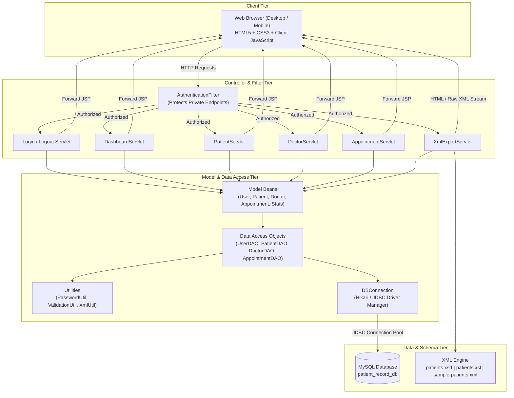
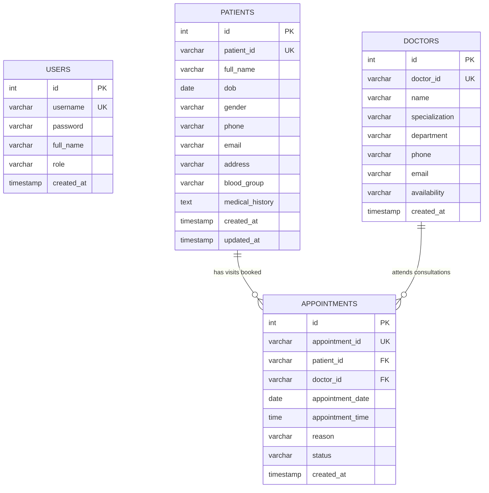

# PROJECT REPORT: PATIENT RECORD MANAGEMENT SYSTEM

**Course:** Web Technology (Assignment-II)  
**Academic Year:** 2026  
**Project Title:** Patient Record Management System  
**Architecture:** MVC (Model-View-Controller) Web Architecture  
**Core Technologies:** Java Servlets, JavaServer Pages (JSP), JDBC, MySQL, XML, XSD, XSLT, HTML5, CSS3, JavaScript  

---

## 1. Abstract

Healthcare organizations generate vast volumes of sensitive clinical and demographic data that require secure, rapid, and structured access. The **Patient Record Management System (RMS)** is a dynamic, server-rendered web application developed using enterprise-grade Java web technologies. It eliminates paper-based patient registration, streamlines physician consultations, and provides structured electronic medical record (EMR) management. Built strictly adhering to the Model-View-Controller (MVC) architectural design pattern, the system features BCrypt cryptographic password hashing, role-governed session interception, multi-criteria patient record searching, dynamic appointment scheduling with chronological constraints, and XML-based clinical interoperability. Using W3C XML Schema (XSD) and Extensible Stylesheet Language Transformations (XSLT), the system validates and transforms patient data into readable, standardized reporting formats.

---

## 2. Introduction

Modern hospital administration demands high operational efficiency, patient record privacy, and seamless interoperability. The **Patient Record Management System** is designed as a lightweight, robust, and beginner-friendly web application developed for college academic assessment and practical laboratory demonstration. 

Rather than relying on heavy, opaque frameworks or external third-party cloud APIs, this system is engineered with native Java 8+ features, Java Servlets 4.0, JavaServer Pages 2.3, standard JDBC drivers, and MySQL relational persistence. It ensures 100% offline self-containment, high reliability, and clear separation of concerns across presentation, business logic, and database access layers.

---

## 3. Problem Statement

Traditional paper-based hospital record handling and fragmented spreadsheet management suffer from severe drawbacks:
1. **Inefficient Information Retrieval:** Locating a patient's historical medical records or contact details requires manual searching through physical archives.
2. **Double Booking and Scheduling Conflicts:** Paper appointment logs lead to accidental duplicate bookings and time slot collisions.
3. **Data Inconsistency and Transcription Errors:** Inconsistent date formats, unverified phone numbers, and illegible clinical notes increase medical risks.
4. **Lack of Interoperability:** Paper records cannot be readily exported or ingested by external healthcare information exchanges or clinical reporting systems.
5. **Security Vulnerabilities:** Plaintext or unmonitored records expose patient history and demographic data to unauthorized personnel.

---

## 4. Objectives of the Proposed System

- **Centralized Demographic & Clinical Repository:** Maintain comprehensive records (Patient ID, name, DOB, gender, phone, email, address, blood group, medical history).
- **Secure Authentication:** Implement database-backed user authentication using 10-round salted BCrypt password hashing and HTTP session enforcement.
- **Dynamic Physician Directory:** Track medical staff, departments, specialties, and consultation availability.
- **Chronologically Constrained Appointment Scheduling:** Facilitate visit scheduling while strictly enforcing temporal constraints (no past dates).
- **Multi-Criteria Search & Inline Editing:** Enable instant record lookup by Patient ID, Name, or Phone, with inline update capabilities.
- **XML Interoperability Pipeline:** Generate standards-compliant XML data, validate it against an XML Schema Definition (XSD), and transform it into presentation-ready HTML reports using XSLT.

---

## 5. Existing System vs. Proposed System

| Dimension | Existing Paper/Manual System | Proposed Patient RMS |
|---|---|---|
| **Record Retrieval** | Manual searching taking several minutes | Instant multi-column database query in milliseconds |
| **Data Integrity** | Prone to human transcription errors | Validated on client (JS) and server (Java) |
| **Authentication** | Physical logbooks with no encryption | Role-based login with BCrypt password hashing |
| **Appointment Tracking** | Hard to track cancellations and completions | Real-time status flags (`SCHEDULED`, `COMPLETED`, `CANCELLED`) |
| **Data Interchange** | Non-standard paper copies | Standardized XML export with XSD validation & XSLT rendering |
| **Audit & Timestamps** | Manual entry | Automated SQL `created_at` and `updated_at` timestamps |

---

## 6. System Architecture

The application adopts the classical **Three-Tier Model-View-Controller (MVC)** architectural pattern:

### Architectural Tiers:
1. **Presentation Tier (View):** Server-rendered JSP views (`dashboard.jsp`, `patients.jsp`, etc.) rendered with JSTL tags, responsive healthcare styling (`style.css`), and validation routines (`validation.js`).
2. **Business & Application Tier (Controller):** Java Servlets handling HTTP requests (`GET`, `POST`), enforcing parameter sanitation, invoking business logic, managing sessions, and directing navigation.
3. **Persistence & Data Tier (Model & Database):** Data Access Objects (DAOs) executing parameterized SQL queries via `PreparedStatement` to prevent SQL injection vulnerabilities.

---

## 7. Database Design & Entity Relationships

The relational schema is implemented in MySQL under database `patient_record_db`. It utilizes foreign key integrity constraints, unique indexes, and automated timestamps.

### Table Specifications:
1. **`users`:** Stores staff user credentials. The `password` column holds 60-character salted BCrypt hashes.
2. **`patients`:** Stores patient profiles. `patient_id` (e.g. `PAT-1001`) is unique and indexed.
3. **`doctors`:** Stores physician rosters with department classifications and availability.
4. **`appointments`:** Connects `patients` and `doctors` via foreign keys. It records scheduled date, time, reason, and status (`SCHEDULED`, `COMPLETED`, `CANCELLED`).

---

## 8. Module Descriptions

### Module 1: Login & Session Security
- **Authentication:** `LoginServlet` intercepts login attempts, reads the corresponding user record from `UserDAO`, and verifies the input against the BCrypt hash.
- **Session Enforcement:** Upon authentication, a secure `HttpSession` is initiated with a 30-minute inactivity timeout. `AuthenticationFilter` intercepts requests to all private URLs and redirects unauthenticated users.
- **Cookie Handling:** A persistent HTTP-only cookie (`saved_username`) stores non-sensitive username preferences for user convenience while passwords are strictly excluded from cookies.

### Module 2: Administrative Dashboard
- `DashboardServlet` aggregates real-time metrics across all tables: Total Patients, Active Doctors, Scheduled Visits, and Completed Visits.
- Provides 8 quick-navigation cards for patient enrollment, record search, physician roster, appointments, and XML processing.
- Presents recent registrations and upcoming consultations in responsive tables.

### Module 3: Patient Registration & Management
- `PatientServlet` handles patient enrollment and generates sequential identifiers (e.g. `PAT-1001`).
- Validates that names contain at least 2 characters, phone numbers consist of 10-15 digits, and Date of Birth is strictly a past date.
- Employs `PreparedStatement` to insert demographic and clinical history data without duplicate ID conflicts.

### Module 4: Patient Records Directory & Multi-Field Search
- Formatted tabular view displaying Patient ID, Full Name, DOB, Gender, Phone, Email, Blood Group, Address, and Medical History.
- Instant search supporting queries across **Patient ID**, **Full Name**, or **Phone Number**.
- Modal editing via `update-patient.jsp` and safe record deletion with confirmation dialogs.

### Module 5: Doctor Details & Specialty Roster
- `DoctorServlet` manages medical practitioners across departments (Cardiology, Neurology, Pediatrics, Orthopedics, General Medicine).
- Captures availability hours (e.g. `Mon-Fri 09:00 AM - 01:00 PM`) to facilitate scheduling.

### Module 6: Appointment Scheduling
- `AppointmentServlet` connects active patients and available doctors.
- Evaluates temporal constraints: appointment dates must be today or in the future.
- Enables staff to transition visit status from `SCHEDULED` to `COMPLETED` or `CANCELLED`.

### Module 7: XML, XSD & XSLT Transformation Center
- **XML Generation:** `XmlUtil.generatePatientXml` converts patient records into well-formed XML with standard headers and full entity escaping (`&amp;`, `&lt;`, `&gt;`, `&quot;`, `&apos;`).
- **XSD Validation:** `patients.xsd` validates the document against strict structural rules.
- **XSLT Transformation:** `patients.xsl` uses XSL templates to transform XML data into styled HTML tables with live aggregate counts.
- **Interactive UI (`xml-view.jsp`):** Offers download links, browser-side transformation previews, server-side HTML conversion, and live XML inspection.

---

## 9. Implementation Details & Code Quality

- **Prepared Statements:** 100% of SQL statements across all DAOs use parameterized `PreparedStatement` instances, eliminating SQL injection risks.
- **Resource Management:** Every database connection, statement, and result set is wrapped in Java 7+ `try-with-resources` blocks to prevent connection leaks.
- **Zero-Dependency UI:** All styles (`style.css`) and validation scripts (`validation.js`) are locally hosted, ensuring the application runs offline during laboratory presentations.
- **Configurability:** Database parameters are decoupled into `db.properties` with support for environment variable overrides.

---

## 10. Verification and Testing Summary

The project was thoroughly verified using an automated JUnit 4 test suite integrated with Apache Maven:
- **Test Results:** 20 test cases executed, 0 failures, 0 errors.
- **Modules Verified:** BCrypt hashing (`PasswordUtilTest`), input validation (`ValidationUtilTest`), XML entity escaping and XSLT transformation (`XmlUtilTest`), data models (`ModelTest`), and database operations (`DaoH2IntegrationTest`).
- **Packaging:** Apache Maven compiled 21 source files with Java 8 compatibility and assembled `patient-management-system.war` (4.58 MB).

---

## 11. Advantages of the System

1. **Lightweight & Fast:** Starts quickly on Apache Tomcat 9 with minimal memory overhead.
2. **Academic Compliance:** Follows standard Java Servlet and JSP conventions without complex third-party framework overhead.
3. **Data Security:** Encrypts user credentials with modern BCrypt hashing.
4. **Offline Self-Contained:** Zero dependencies on external CDNs or cloud APIs.
5. **Standards-Compliant Interoperability:** Uses W3C XML, XSD, and XSLT standards for clinical data interchange.

---

## 12. Limitations & Future Enhancements

### Current Limitations:
- **Single-Location Scope:** Designed for single hospital or clinic deployments.
- **No Direct SMS/Email Gateway:** Patient notifications are displayed in-app rather than sent via external SMS/SMTP gateways.

### Future Enhancements:
- **Role-Based Access Control (RBAC):** Separate portals for Doctors, Patients, and Laboratory Technicians.
- **Electronic Prescription (e-Rx) Generation:** Direct generation of printable prescriptions linked to consultations.
- **HL7 / FHIR Standards Integration:** Upgrading the XML pipeline to modern FHIR JSON/REST standards for regional healthcare networks.

---

## 13. Conclusion

The **Patient Record Management System** successfully satisfies all requirements of the Web Technology Assignment-II curriculum. By integrating Java Servlets, JavaServer Pages, JDBC, MySQL, and the W3C XML/XSD/XSLT processing pipeline, the application provides an end-to-end hospital management solution that is secure, responsive, and ready for academic submission and live demonstration.
